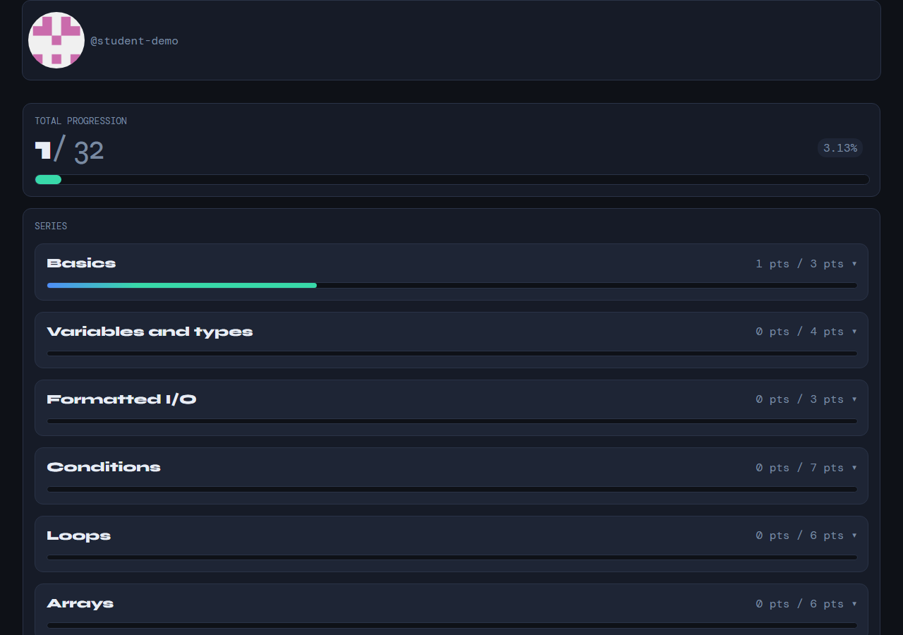

# ARGOS

ARGOS is a bank of C programming exercises with automated tests. You work on
the exercises locally, and the `argos` CLI compiles your code, runs the tests
and shows your progress on a dashboard.

## Getting started

1. **Fork this repository** (button at the top of this page) — every student
   works on their own fork, named `<your-login>/ARGOS`.
2. **Clone your fork**:

   ```bash
   git clone https://github.com/<your-login>/ARGOS.git
   cd ARGOS
   ```

3. **Activate your learning path** (your teacher gives you its id):

   ```powershell
   .\argos.exe learning-path add <learning-path-id>
   ```

   This copies the exercises of the learning path into the `Exercises/`
   folder — that is where you work.

   Example, for the HE-Arc 1242.1 C course:

   ```powershell
   .\argos.exe learning-path add HE-Arc_1242.1_C
   ```

## Doing an exercise

1. Pick an exercise from the catalogue below and read its statement (the
   `README.fr.md` / `README.en.md` files linked in the table).
2. Edit the exercise source in `Exercises/ex_NNNN_Name/` — each exercise
   tells you which function to write. The `main.c` next to it is a free
   sandbox: use it to call your function and test it by hand.

   Example, for exercise 0001: write the body of `ex_0001_PrintHelloWorld`
   in `Exercises/ex_0001_PrintHelloWorld/ex_0001_PrintHelloWorld.c`.
3. Compile by hand, from the exercise folder, with the course command:

   ```powershell
   cd Exercises/ex_NNNN_Name
   gcc -Wall -Wextra -Wpedantic -Werror -std=c23 -o main.exe main.c ex_NNNN_Name.c
   ```

   Fix every error and warning until it compiles, then run your program:

   ```powershell
   .\main.exe
   ```

   Try several inputs and compare with what the statement expects.

   Example, for exercise 0001:

   ```powershell
   cd Exercises/ex_0001_PrintHelloWorld
   gcc -Wall -Wextra -Wpedantic -Werror -std=c23 -o main.exe main.c ex_0001_PrintHelloWorld.c
   .\main.exe
   ```

   The program prints `hello, world`.
4. Only once your code compiles and you have tested it, check your solution
   from the project root. On Windows:

   ```powershell
   .\argos.exe check <exercise-id>
   ```

   On Linux/macOS (Python ≥ 3.12):

   ```bash
   python argos.py check <exercise-id>
   ```

   Example, for exercise 0001 (back at the project root):

   ```powershell
   cd ../..
   .\argos.exe check 0001
   ```

   Without an id, `check` runs every exercise of your selected learning
   paths. Each exercise earns points based on its difficulty (easy = 1,
   medium = 2, hard = 5); a series is completed when you reach its points
   target — you do not need to solve every exercise.

When your teacher updates the exercises, pull the changes from this
repository into your fork, then run `.\argos.exe sync` (a `git pull` also
triggers it automatically).

## Dashboard

Every `check` updates your dashboard, a local web page showing your total
progression and your points per series. Its path is printed at the end of
`check` (ctrl+click to open it):

```text
Dashboard (ctrl+click to open): <project>\.argos\dashboards\student\index.html
```

Keep it open while you work: it refreshes by itself after each `check`.



## Exercises

<!-- CATALOGUE:BEGIN -->
| ID | Exercise | Tested skills | Difficulty |
|----|----------|---------------|------------|
| 0001 | [Print Hello World](.argos/exercises/ex_0001_PrintHelloWorld/README.en.md) · [fr](.argos/exercises/ex_0001_PrintHelloWorld/README.fr.md) | basics | 🟢 easy |
| 0002 | [Print Math Calc](.argos/exercises/ex_0002_PrintMathCalc/README.en.md) · [fr](.argos/exercises/ex_0002_PrintMathCalc/README.fr.md) | arithmetic operators | 🟢 easy |
| 0003 | [Some Calculus](.argos/exercises/ex_0003_SomeCalculus/README.en.md) · [fr](.argos/exercises/ex_0003_SomeCalculus/README.fr.md) | arithmetic operators, variables and types | 🟢 easy |
| 0004 | [Swap](.argos/exercises/ex_0004_Swap/README.en.md) · [fr](.argos/exercises/ex_0004_Swap/README.fr.md) | variables and types | 🟢 easy |
| 0005 | [Celsius to Fahrenheit](.argos/exercises/ex_0005_CelsiusToFahrenheit/README.en.md) · [fr](.argos/exercises/ex_0005_CelsiusToFahrenheit/README.fr.md) | basics, arithmetic operators, formatted input/output | 🟢 easy |
| 0006 | [Asset Interest Rate](.argos/exercises/ex_0006_AssetInterestRate/README.en.md) · [fr](.argos/exercises/ex_0006_AssetInterestRate/README.fr.md) | basics, arithmetic operators, variables and types, formatted input/output | 🟡 medium |
<!-- CATALOGUE:END -->

## License

ARGOS — the CLI, tests, exercise statements and skeletons — is released under
the [MIT License](LICENSE).
